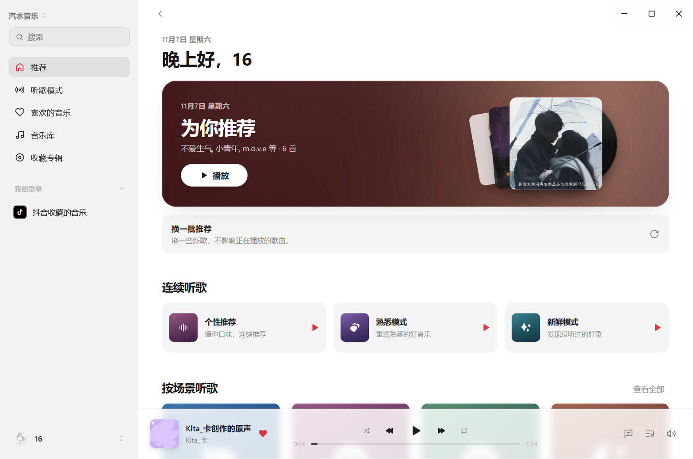
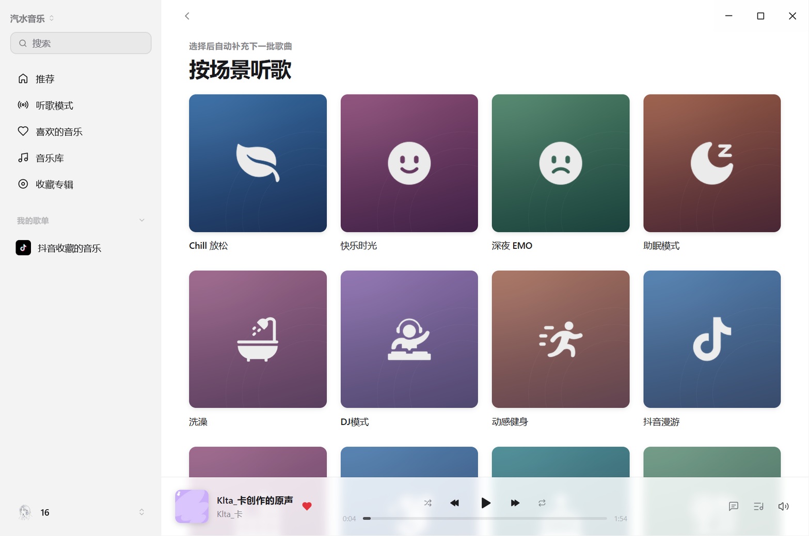

# MyGo 汽水音乐插件

在 MyGo Music 中使用汽水音乐账号，收听喜欢的歌曲、浏览歌单、搜索音乐，并持续播放个性推荐与场景电台。支持 Windows x64 与 macOS Apple Silicon。

当前版本 **0.6.12**，兼容原版 **MyGo Music v0.1.24**。播放保留 AAC-LC／FLAC 原编码，无需安装 FFmpeg。Windows 还提供可选的小图标听歌模式和任务栏播放条，增强助手随插件提供。

**Windows x64 与 Apple Silicon Mac 均无需安装汽水音乐官方客户端，也无需 FFmpeg。** 所需汽水组件由插件自动下载、校验并提取；首次准备 Windows 约下载 144 MiB，Mac 约下载 18 MiB。仍需安装对应架构的 Node.js 24+。

[下载最新版](https://github.com/yiyiSmallti/mygo-qishui/releases/tag/v0.6.12) · [详细使用指南](qishui-account/README.md) · [历史变更与验证记录](docs/history.md) · [反馈问题](https://github.com/yiyiSmallti/mygo-qishui/issues)

本项目是独立适配，不是 MyGo 或汽水音乐的官方发行版。

## 平台支持

| 平台 | 需要准备 | 安装包 |
| --- | --- | --- |
| Windows x64 | x64 Node.js 24+、WebView2 Runtime；汽水组件自动准备 | `plugin-windows-amd64.zip` |
| macOS Apple Silicon | ARM64 Node.js 24+；汽水组件自动准备，使用系统 WebKit | `plugin-darwin-arm64.zip` |
| macOS Intel / Linux | 暂无已验证的安装包 | — |

## 快速开始

1. 准备 MyGo Music v0.1.24 和 **Node.js 24 或更新版本**。Windows 还需要 WebView2 Runtime；Mac 使用系统 WebKit。
2. 在 MyGo「设置 → 插件 → ＋ → 从 GitHub 安装」输入 `yiyiSmallti/mygo-qishui`。本机安装可从发布页下载对应平台的 `plugin-*.zip`，勿选择源码 ZIP。
3. 启用汽水音乐插件并允许运行辅助程序，在账号菜单选择汽水音乐登录，用手机汽水 App 扫码确认。
4. 登录后即可访问音乐库、搜索、推荐和听歌模式。出现官方安全验证时，在插件自带登录窗口继续完成。

**Windows 无需安装完整汽水客户端**：缺少组件时，插件从汽水官方安装包下载、校验并提取所需组件。首次准备约需下载 144 MiB，系统 `tar.exe` 需支持该归档格式。**Apple Silicon Mac 也会自动准备组件**，首次约需下载 18 MiB 的官方精简归档。两端都不需要启动官方客户端，也不读取它的现有账号。依赖详情见 [本机依赖](qishui-account/README.md#本机依赖)。

### 已安装用户如何更新

GitHub 来源插件在 **汽水插件菜单 → 检查更新** 中升级到 0.6.12。本机来源插件下载相应平台 ZIP，从本机升级即可。保留 `plugin-data`，已有账号和有效缓存可继续使用。

原版 MyGo 会定期检查 GitHub 来源插件更新，安装更新仍需主动点击。MyGo 自身的应用更新与汽水插件更新是两个入口。

### 小图标和任务栏播放条

这些是 Windows 可选界面增强。原版 MyGo 首次从汽水侧栏「界面增强 → 打开增强管理」进入；安装后可从「设置 → 插件 → 汽水音乐 → 界面增强」打开。助手会检查兼容性，只有确认后才备份并更新主程序、从原路径重启。

任务栏播放条在 MyGo 设置中开启或关闭。官方 MyGo 更新可能覆盖本地界面增强，可再打开增强管理检查；具体构建与回退见 [增强说明](patches/README.md)。

## 功能介绍

### 汽水音源插件

| 模块 | 功能 |
| --- | --- |
| 账号登录 | 在插件自带窗口扫码并完成官方二次验证；成功后再校验账号身份并保存登录。显示头像与昵称，支持退出登录，失败或关窗保留原账号。 |
| 音乐库 | 读取自建歌单、收藏歌单、喜欢的音乐、抖音收藏和收藏专辑；提供详情页与手动刷新。 |
| 搜索与详情 | 搜索歌曲、专辑、艺人和歌单；支持分页，以及歌单曲目、专辑曲目和艺人作品。 |
| 音频播放 | 播放当前账号获完整授权的歌曲和上传原声；内置 CENC 解密，保留 AAC-LC／FLAC 原编码并检查完整时长，本地缓存按账号隔离。 |
| 歌词 | 读取逐行、逐字歌词，交由 MyGo 展示。 |
| 个性推荐 | 当前账号推荐、换一批推荐、个性／熟悉／新鲜三种模式、场景与发现电台；连续补歌并去除重复曲目。 |
| 喜欢状态 | 显示歌曲是否喜欢；主动点击心形按钮时添加或取消喜欢，支持普通歌曲和上传原声。 |
| 听歌模式封面 | 主模式与场景保留本地彩底封面；常用模式另提供随主题着色的透明小图标，探索电台使用服务端真实封面。 |

### Windows 可选界面增强

Windows 安装包已附带增强安装助手。确认安装后可获得以下功能；普通音源功能可直接使用原版 MyGo。源码补丁见 [patches/README.md](patches/README.md)。

- **任务栏快捷播控**：透明、无系统外框的常驻播放条；共用主窗口的播放队列，主窗口隐藏到托盘后仍可控制播放。大号歌词按真实逐字时间扫亮，长句跟随当前唱词。
- **左右停靠与关闭**：按住封面或歌词直接拖动，播放条随鼠标移动；圆角吸附框标出松手后的实际位置，随左右方向切换。松手后停靠并保存，按 Esc 可取消；吸附框随即消失。鼠标进入播放条任意区域即显示右上角关闭按钮，移出后隐藏；关闭播放条后音乐继续播放，设置中的位置选项仅作为备用入口。
- **适配任务栏空间**：随可用空间缩小或隐藏，避免遮挡任务栏按钮；右侧较窄时精简播控，极窄空间仅保留封面和必要按钮。文字和图标跟随 Windows 任务栏深浅主题。
- **听歌模式新布局**：常用模式小图标横卡，探索模式宽幅封面与文字叠放，宽窗四列、窄窗自动减少列数；未列入常用的场景仍可访问。
- **紧凑推荐页**：听歌模式横卡、刷新与导航操作行；场景、电台和歌单显示少量预览，通过“查看全部”打开完整内容。
- **主动刷新**：点击刷新入口重新请求内容，普通页面导航继续使用缓存。

### “喜欢”和“收藏”有什么区别？

| 入口 | 内容与操作 |
| --- | --- |
| 喜欢的音乐 | 喜欢的单首歌曲；可通过心形按钮添加或取消。同名喜欢歌单卡已去重。 |
| 收藏专辑 | 收藏的整张专辑，当前只读。 |
| 音乐库 → 收藏歌单 | 收藏的歌单，当前只读。 |
| 抖音收藏 | 独立来源的收藏内容，保留单独入口。 |

“听歌模式”决定推荐什么内容；顺序、随机和循环播放仍由 MyGo 原有播放控制栏设置。

## 界面截图

以下均为 Windows 实机截图。2026-11-08 的左侧任务栏和拖动吸附框使用 MyGo v0.1.22 配套补丁；听歌模式页与右侧停靠截图使用 v0.1.21，插件均为 0.5.0。推荐首页保留 2026-11-07 的 0.4.2 截图。推荐内容随账号和刷新时间变化，页面跟随 MyGo 的深浅主题。

### 推荐首页

显示当前账号的推荐歌曲；“换一批推荐”位于歌曲下方，个性推荐、熟悉和新鲜模式使用紧凑横卡。刷新推荐不会打断正在播放的歌曲。



### 听歌模式

常用模式显示为两行四列的小图标横卡，包括熟悉、新鲜、放松、快乐、健身、夜晚、治愈与小酒馆。下方使用宽幅封面展示探索模式，标题与说明叠放在封面下方；窄窗口自动减少列数。点击模式后连续补充歌曲。



### 透明任务栏播放条

任务栏常驻条提供封面、歌曲信息、上一首、播放／暂停、下一首及喜欢按钮。0.5.0 配套补丁放大了歌词，并根据真实逐字时间显示渐进高亮；仅有整行时间时显示整行歌词。点击歌曲信息可返回主窗口。按住封面或歌词区域，播放条会随鼠标水平移动；圆角吸附框提示最终落点，在任务栏左半边或右半边松手，即吸附到对应的空闲位置并保存，无需进入设置。鼠标进入整个播放条时显示右上角的小关闭按钮，移出后隐藏（键盘聚焦也可显示）；点击后隐藏播放条但继续播放，可在设置中重新开启。

下图展示完整 Windows 任务栏，包含播放条、应用图标、系统托盘与时钟。较窄的右侧空间会使用精简播控，优先保留歌词；极窄空间仅显示封面和必要按钮，空间不足时隐藏播放条，避免遮挡系统按钮。


[查看完整任务栏原图（2560 × 72）](docs/screenshots/taskbar-full.png)

拖动中的吸附框：播放条跟随鼠标，左侧淡色圆角框标明松手后的落点；移向右半边会切换到右侧可用位置，松手后框消失。


[查看拖动吸附框原图（2560 × 72）](docs/screenshots/taskbar-snap-full.png)

右侧停靠示例（同样保留完整任务栏；此时空闲空间仅容纳封面与必要播控）：


## 使用范围

- 播放取决于当前账号的服务端授权。插件只使用完整授权音频，不把试听片段当作整首；支持歌曲和上传原声，暂不支持视频作品。
- 当前版本支持已适配的 AAC-LC／FLAC 与 CENC 音频。未知加密、分片媒体、密钥轮换或不支持的 AAC 规格会明确提示。
- 音乐库按接口游标分页：单个歌单最多载入 5000 首，歌单／收藏列表最多 2000 项；未加载完整时会显示说明。
- 歌单和专辑收藏当前只读。主动点击心形按钮或对应快捷键，才会添加或取消汽水账号中的歌曲喜欢。
- Node.js 和系统网页运行时仍需准备。Windows x64 与 Apple Silicon Mac 均支持自动准备汽水组件，无需安装官方客户端。播放不依赖 FFmpeg。Intel Mac 和 Linux 尚无已验证安装包。

Windows 0.6.7 的当前实机状态来自用户反馈；各轮自动化检查、真实账号和专项验证的范围见 [验证记录](docs/history.md)。

## 开发与验证

需要 Node.js 24，无需安装 npm 依赖：

```sh
npm test
```

0.6.12 修复任务栏播放按钮的常驻底色，并支持从 0.6.12 增强版升级。验证范围见发布说明；新版增强尚未进行 Windows 实机安装交互验证。

0.6.8 已通过 8 项 Mac 组件准备检查、8 组私有组件真实播放检查和 2 项 Windows 准备锁回归，正式账号数据未修改。`scripts/verify-mac-sdk.mjs` 可复现自动准备与匿名设备注册检查。

当前有 130 项插件回归测试；0.6.7 另通过 21 项加密样本校验和 8 组完整播放流程检查。`scripts/verify-cenc.mjs` 使用生成音频与独立基准核对解密；`scripts/verify-media-pipeline.mjs` 从插件入口覆盖解码、跳转、缓存、并发、取消与异常清理。FFmpeg 仅是这些验证脚本的工具，不是插件播放依赖。

解码验证程序源码见 [verification/mygo-media-decoder.go.txt](verification/mygo-media-decoder.go.txt)。`verify-live-media.mjs` 使用已有插件会话进行只读查询，音频只写入隔离临时缓存，结束后删除，不安装插件或修改正式账号。完整执行方法与检查范围见 [验证记录](docs/history.md)。

### 构建与发布

MyGo 插件更新只读取 GitHub 最新正式 Release，跳过 Pre-release。正式发布需设为 Latest 并提供 `plugin-windows-amd64.zip` 与 `plugin-darwin-arm64.zip`。发布两个平台插件包及源码；Windows 包内含可选样式安装组件，无需单独下载播放器包。登录不要求修改主程序。

[MyGo 官方发布说明](https://github.com/egoist/mygo-music#publishing-a-plugin) 使用 GitHub Topic `mygo-music-plugin` 发现公开仓库；[官网插件页](https://cloudmusic.egoist.dev/plugins/) 的结果取决于 GitHub 搜索索引和页面缓存，并不代表官方认证。

构建需要 Go 1.27.3 与 Node.js 24+。先运行 `node scripts/build-login-helper.mjs` 和 `node scripts/build-style-player.mjs <未修改的-MyGo-v0.1.24-源码目录>`，再运行 `go -C login-helper run ./cmd/package -root .. -native ../dist/login-helper -out ../dist`（或 PowerShell 的 `./scripts/package-plugin.ps1`）。输出两个平台专用 ZIP 与 `SHA256SUMS`；Mac ZIP 中保留登录组件的可执行权限。构建与验证方法见 [login-helper](login-helper/README.md)。

## 目录

| 路径 | 内容 |
| --- | --- |
| `qishui-account/` | 可安装的插件源码与界面封面 |
| `tests/` | 插件模拟回归测试 |
| `research/` | 三个经过筛选的源码片段和两个对应测试，仅供现有测试使用 |
| `patches/` | MyGo v0.1.24 与 v0.1.21 的对应增量补丁、构建说明和上游许可证 |
| `scripts/` | 本地测试入口与图标预处理工具 |
| `docs/screenshots/` | README 使用的实机界面截图 |
| `docs/history.md` | 历史版本与各轮验证记录 |

## 来源

- [MyGo Music](https://github.com/egoist/mygo-music/tree/v0.1.24)
- [汽水音乐](https://qishui.douyin.com/)
- [第三方来源与许可说明](THIRD_PARTY_NOTICES.md)

Assisted-by: Cindy (https://cindy.app)
